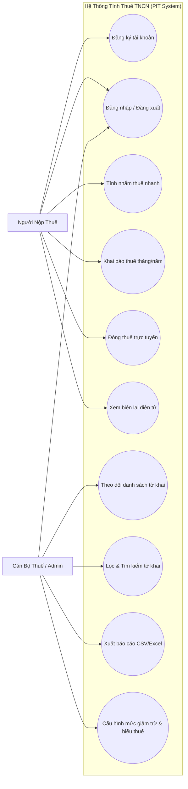

# TÀI LIỆU ĐẶC TẢ YÊU CẦU PHẦN MỀM (SRS)
## HỆ THỐNG TÍNH THUẾ THU NHẬP CÁ NHÂN (PIT SYSTEM)
### Chuẩn IEEE Std 830-1998 / ISO/IEC/IEEE 29148

---

## 1. GIỚI THIỆU TỔNG QUAN (INTRODUCTION)

### 1.1. Mục đích tài liệu
Tài liệu này đặc tả toàn bộ các yêu cầu chức năng (Functional Requirements - FR) và phi chức năng (Non-Functional Requirements - NFR) cho **Hệ thống Tính thuế Thu nhập Cá nhân (Personal Income Tax - PIT System)**. Tài liệu là căn cứ pháp lý và kỹ thuật phục vụ việc thiết kế kiến trúc, cài đặt mã nguồn, lập kế hoạch kiểm thử (Test Plan) và thiết kế ca kiểm thử (Test Cases) cho môn học **Kiểm thử Phần mềm**.

### 1.2. Phạm vi hệ thống
Hệ thống là ứng dụng Web quản lý và tính toán thuế thu nhập cá nhân tự động theo Luật Thuế TNCN Việt Nam hiện hành, bao gồm hai nhóm chức năng cốt lõi:
1. **Nhóm chức năng 1: Người nộp thuế (Taxpayer)**: Đăng ký tài khoản, đăng nhập, khai báo thuế, tính thuế tự động theo biểu lũy tiến từng phần 7 bậc, đóng thuế trực tuyến và nhận biên lai điện tử.
2. **Nhóm chức năng 2: Quản trị viên / Cán bộ thuế (Admin)**: Theo dõi danh sách tờ khai, lọc và tìm kiếm theo kỳ tính thuế, xuất báo cáo quyết toán ra file Excel/CSV, cấu hình các tham số giảm trừ và thuế suất.

### 1.3. Định nghĩa và Thuật ngữ viết tắt
| Thuật ngữ | Tiếng Anh đầy đủ | Giải thích |
| :--- | :--- | :--- |
| **PIT** | Personal Income Tax | Thuế thu nhập cá nhân (TNCN) |
| **TNCT** | Taxable Income | Thu nhập chịu thuế = Tổng thu nhập - Thu nhập miễn thuế |
| **TNTT** | Assessed / Assessable Income | Thu nhập tính thuế = TNCT - Tổng các khoản giảm trừ |
| **GTGC** | Family Deductions | Giảm trừ gia cảnh (bản thân + người phụ thuộc) |
| **BHXH / BHYT / BHTN** | Social/Health/Unemployment Insurance | Bảo hiểm xã hội (8%), Y tế (1.5%), Thất nghiệp (1%) |
| **KBNN** | State Treasury | Kho bạc Nhà nước |
| **SRS** | Software Requirements Specification | Tài liệu đặc tả yêu cầu phần mềm |
| **POM** | Page Object Model | Mô hình thiết kế kiểm thử tự động Web |

### 1.4. Tài liệu tham chiếu
- Luật Thuế Thu nhập cá nhân số 04/2007/QH12 và Luật sửa đổi, bổ sung số 26/2012/QH13.
- Nghị quyết số 954/2020/UBTVQH14 về điều chỉnh mức giảm trừ gia cảnh thuế TNCN.
- Tiêu chuẩn IEEE Std 830-1998: IEEE Recommended Practice for Software Requirements Specifications.
- Tiêu chuẩn IEEE Std 829-2008: Standard for Software and System Test Documentation.

---

## 2. MÔ TẢ TỔNG THỂ HỆ THỐNG (OVERALL DESCRIPTION)

### 2.1. Sơ đồ Use Case Tổng thể

### 2.2. Các tác nhân hệ thống (Actors)
1. **Khách vãng lai (Guest)**: Chưa đăng nhập, có thể tra cứu thông tin chung và sử dụng công cụ tính nhẩm thuế nhanh trên trang chủ.
2. **Người nộp thuế (Taxpayer)**: Cá nhân có thu nhập từ tiền lương, tiền công; đã đăng ký tài khoản có Mã số thuế (MST) và CCCD; có quyền kê khai thuế, xem bảng tính thuế chi tiết, nộp thuế trực tuyến và lưu biên lai.
3. **Cán bộ thuế / Quản trị viên (Admin)**: Người quản lý hệ thống thuế; có quyền giám sát toàn bộ tờ khai của công dân, duyệt/kiểm tra tờ khai, xuất báo cáo tổng hợp ra file phục vụ thanh tra, và điều chỉnh các thông số cấu hình mức giảm trừ khi nhà nước ban hành quy định mới.

---

## 3. QUY TẮC NGHIỆP VỤ (BUSINESS RULES - BR)

- **BR-01: Thu nhập chịu thuế (TNCT)**:
  $$\text{TNCT} = \text{Tổng thu nhập} - \text{Thu nhập miễn thuế}$$
  Trong đó, Tổng thu nhập bao gồm lương chính, thưởng và thu nhập chịu thuế khác.
- **BR-02: Mức giảm trừ cho bản thân người nộp thuế**:
  Áp dụng mức cố định **11.000.000 VNĐ / tháng** (hoặc 132.000.000 VNĐ / năm) theo Nghị quyết 954/2020/UBTVQH14. Cho phép cấu hình thay đổi theo chính sách mới.
- **BR-03: Mức giảm trừ cho mỗi người phụ thuộc**:
  Áp dụng mức cố định **4.400.000 VNĐ / tháng / người** (hoặc 52.800.000 VNĐ / năm / người). Số người phụ thuộc phải là số nguyên $\ge 0$.
- **BR-04: Các khoản bảo hiểm bắt buộc được khấu trừ**:
  - Bảo hiểm xã hội (BHXH): 8%
  - Bảo hiểm y tế (BHYT): 1.5%
  - Bảo hiểm thất nghiệp (BHTN): 1%
  - Tổng tỷ lệ khấu trừ bảo hiểm: 10.5% tính trên mức lương chính, có trần tiền lương đóng bảo hiểm (tối đa 20 lần mức lương cơ sở, tương đương 46.800.000 VNĐ/tháng).
- **BR-05: Thu nhập tính thuế (TNTT)**:
  $$\text{TNTT} = \text{TNCT} - (\text{Giảm trừ bản thân} + \text{Giảm trừ người phụ thuộc} + \text{Bảo hiểm bắt buộc} + \text{Từ thiện})$$
  - Nếu $\text{TNTT} \le 0$: Thuế TNCN phải nộp = 0 VNĐ.
  - Nếu $\text{TNTT} > 0$: Thuế TNCN được tính theo biểu thuế lũy tiến từng phần.
- **BR-06: Biểu thuế lũy tiến từng phần 7 bậc (Điều 22 Luật Thuế TNCN)**:

| Bậc | Phần TNTT / tháng (VNĐ) | Thuế suất | Thuế tối đa của bậc | Thuế lũy kế tối đa đến bậc |
| :---: | :--- | :---: | :---: | :---: |
| **1** | Đến 5.000.000 | 5% | 250.000 | 250.000 |
| **2** | Trên 5.000.000 đến 10.000.000 | 10% | 500.000 | 750.000 |
| **3** | Trên 10.000.000 đến 18.000.000 | 15% | 1.200.000 | 1.950.000 |
| **4** | Trên 18.000.000 đến 32.000.000 | 20% | 2.800.000 | 4.750.000 |
| **5** | Trên 32.000.000 đến 52.000.000 | 25% | 5.000.000 | 9.750.000 |
| **6** | Trên 52.000.000 đến 80.000.000 | 30% | 8.400.000 | 18.150.000 |
| **7** | Trên 80.000.000 | 35% | Không giới hạn | Không giới hạn |

- **BR-07: Phương pháp tính thuế rút gọn**:
  - Bậc 1: $\text{Thuế} = \text{TNTT} \times 5\%$
  - Bậc 2: $\text{Thuế} = \text{TNTT} \times 10\% - 250.000$
  - Bậc 3: $\text{Thuế} = \text{TNTT} \times 15\% - 750.000$
  - Bậc 4: $\text{Thuế} = \text{TNTT} \times 20\% - 1.650.000$
  - Bậc 5: $\text{Thuế} = \text{TNTT} \times 25\% - 3.250.000$
  - Bậc 6: $\text{Thuế} = \text{TNTT} \times 30\% - 5.850.000$
  - Bậc 7: $\text{Thuế} = \text{TNTT} \times 35\% - 9.850.000$
- **BR-08: Trạng thái và Quy trình nộp thuế**:
  - Tờ khai mới tạo: Nếu thuế > 0 thì trạng thái là `PENDING` (Chờ đóng thuế); nếu thuế = 0 thì tự động chuyển `PAID` (Hoàn tất).
  - Khi người dùng hoàn thành giao dịch đóng thuế, hệ thống sinh mã giao dịch duy nhất, chuyển trạng thái sang `PAID` và cấp Biên lai điện tử có mã tra cứu.

---

## 4. YÊU CẦU CHỨC NĂNG CHI TIẾT (FUNCTIONAL REQUIREMENTS - FR)

### 4.1. Nhóm 1: Người nộp thuế (Taxpayer)

#### FR-01: Đăng ký tài khoản người nộp thuế
- **Mô tả**: Cho phép công dân đăng ký tài khoản kê khai thuế mới.
- **Dữ liệu vào**: Tên đăng nhập (3-30 ký tự), Mật khẩu ($\ge 6$ ký tự), Họ tên, Email, Số điện thoại (10 số), MST (10 số), CCCD (12 số).
- **Ràng buộc**: Tên đăng nhập không được trùng lặp; dữ liệu phải qua kiểm tra định dạng tại `ValidationUtil`.
- **Kết quả**: Tạo tài khoản role `TAXPAYER`, lưu phiên làm việc và chuyển vào Dashboard.

#### FR-02: Đăng nhập & Đăng xuất
- **Mô tả**: Xác thực tài khoản người dùng và phân quyền làm việc.
- **Dữ liệu vào**: Tên đăng nhập và Mật khẩu.
- **Kết quả**: Điều hướng chính xác theo vai trò: Taxpayer vào `/dashboard.html`, Admin vào `/admin.html`. Khi đăng xuất, hủy hoàn toàn HTTP session.

#### FR-03: Công cụ tính nhẩm thuế nhanh (Quick Calculator)
- **Mô tả**: Cho phép người dùng nhập thử thu nhập và số người phụ thuộc để xem bảng phân bổ thuế theo 7 bậc mà không cần đăng nhập.
- **Dữ liệu vào**: Lương chính, Thưởng, Thu nhập khác, Thu nhập miễn thuế, Số người phụ thuộc, Từ thiện.
- **Kết quả**: Hiển thị tổng thu nhập, tổng giảm trừ, thu nhập tính thuế, tiền thuế phải nộp, thu nhập thực nhận (Net) và bảng chi tiết từng bậc thuế.

#### FR-04: Kê khai thông tin thuế (Tax Declaration)
- **Mô tả**: Người nộp thuế lập và nộp tờ khai thuế cho kỳ tính thuế cụ thể.
- **Dữ liệu vào**: Năm (2020-2030), Tháng (1-12 hoặc 0 nếu quyết toán năm), Lương chính, Thưởng, Thu nhập khác, Thu nhập miễn thuế, Số người phụ thuộc, Đóng góp từ thiện.
- **Xử lý**: Hệ thống tính toán thuế tự động, gán mã tờ khai `DEC-xxxxxx`, lưu vào danh sách tờ khai của người dùng.
- **Kết quả**: Tờ khai được tạo với trạng thái `PENDING` hoặc `PAID`.

#### FR-05: Đóng thuế trực tuyến (Online Payment Gateway Simulation)
- **Mô tả**: Người nộp thuế thực hiện thanh toán số tiền thuế của tờ khai đang ở trạng thái `PENDING`.
- **Dữ liệu vào**: Mã tờ khai, Phương thức thanh toán (`VNPAY_QR`, `BANK_TRANSFER`, `CREDIT_CARD`).
- **Xử lý**: Kiểm tra tờ khai hợp lệ và chưa thanh toán, tạo mã biên lai `REC-xxxxx`, tạo mã giao dịch ngân hàng `TXN-xxxxxxxx`, cập nhật trạng thái tờ khai sang `PAID`.
- **Kết quả**: Thông báo thanh toán thành công và mở Biên lai điện tử.

#### FR-06: Tra cứu & In biên lai nộp thuế điện tử
- **Mô tả**: Xem chi tiết biên lai nộp thuế vào Ngân sách Nhà nước.
- **Kết quả hiển thị**: Tên người nộp thuế, MST, Số tiền nộp, Mã giao dịch, Thời gian thanh toán, Trạng thái thành công, dấu chứng thực điện tử của Cơ quan Thuế; hỗ trợ nút In biên lai.

---

### 4.2. Nhóm 2: Quản trị viên / Cán bộ thuế (Admin)

#### FR-07: Theo dõi danh sách tờ khai thuế toàn hệ thống
- **Mô tả**: Cán bộ thuế xem danh sách tất cả các tờ khai do người nộp thuế nộp lên.
- **Thông tin hiển thị**: Mã tờ khai, Họ tên, MST, CCCD, Kỳ khai, Tổng thu nhập, Tổng giảm trừ, TNTT, Số thuế phải nộp, Trạng thái.
- **Tổng hợp số liệu**: Hiển thị bảng thống kê tự động tổng số tờ khai, tổng tiền thuế đã thu vào KBNN, tổng tiền thuế còn nợ chờ nộp.

#### FR-08: Lọc và Tìm kiếm tờ khai nâng cao
- **Mô tả**: Hỗ trợ cán bộ thuế tra cứu tờ khai theo nhiều tiêu chí kết hợp:
  - Lọc theo Năm (ví dụ: 2026, 2025).
  - Lọc theo Tháng (Tháng 1 đến 12, hoặc Cả năm).
  - Lọc theo Trạng thái (`ALL`, `PAID`, `PENDING`).
  - Tìm kiếm theo từ khóa: Khớp Họ tên, Mã số thuế, Số CCCD hoặc Mã tờ khai.

#### FR-09: Xuất báo cáo quyết toán thuế (Export Report)
- **Mô tả**: Xuất dữ liệu tờ khai thuế ra file CSV phục vụ kiểm toán và báo cáo lãnh đạo.
- **Định dạng file**: File CSV mã hóa UTF-8 kèm ký tự BOM (`\uFEFF`) để phần mềm Microsoft Excel hiển thị tiếng Việt có dấu chuẩn xác 100%, không bị lỗi font.
- **Nội dung file**: Đầy đủ các cột Mã tờ khai, Họ tên, MST, CCCD, Năm, Tháng, Tổng thu nhập, Giảm trừ, TNTT, Thuế TNCN, Thực nhận, Trạng thái, Ngày khai.

#### FR-10: Cấu hình tham số hệ thống thuế (System Configuration)
- **Mô tả**: Cán bộ thuế điều chỉnh các tham số chính sách thuế khi nhà nước ban hành quy định mới.
- **Các tham số cấu hình**:
  - Mức giảm trừ gia cảnh bản thân (VNĐ/tháng).
  - Mức giảm trừ người phụ thuộc (VNĐ/tháng/người).
  - Tỷ lệ đóng BHXH (%), BHYT (%), BHTN (%).
  - Mức trần lương tính bảo hiểm bắt buộc (VNĐ).
- **Ràng buộc**: Các tham số không được là số âm; cập nhật có hiệu lực tức thời cho các phép tính thuế tiếp theo.
- **Tính năng bổ sung**: Nút "Khôi phục mặc định" đưa toàn bộ tham số về chuẩn hiện hành theo Luật Thuế TNCN.

---

## 5. YÊU CẦU PHI CHỨC NĂNG (NON-FUNCTIONAL REQUIREMENTS - NFR)

### NFR-01: Hiệu năng (Performance)
- Hệ thống xử lý API tính thuế nhanh và nộp tờ khai với thời gian phản hồi (Response Time) $\le 200\text{ ms}$ ở điều kiện thông thường.
- Chịu tải đồng thời tối thiểu 100 concurrent users với tỷ lệ lỗi (Error Rate) $< 1\%$ (được kiểm chứng qua kịch bản Apache JMeter trong YC 8).

### NFR-02: Bảo mật (Security)
- Kiểm soát phân quyền dựa trên vai trò (Role-Based Access Control - RBAC): Chặn tuyệt đối người nộp thuế thường truy cập vào các API và màn hình quản trị `/admin.html` (HTTP 403 Forbidden).
- Quản lý phiên làm việc bằng Session HTTP an toàn.
- Kiểm tra hợp lệ dữ liệu đầu vào (Input Sanitization) tại cả client và server, phòng chống tấn công chèn mã độc (XSS, SQL Injection).

### NFR-03: Khả năng sử dụng (Usability)
- Giao diện 100% tiếng Việt chuẩn mực, thuật ngữ tài chính - thuế chính xác.
- Thiết kế Responsive tương thích máy tính để bàn (Desktop), máy tính bảng (Tablet) và điện thoại di động (Mobile).
- Định dạng tiền tệ VNĐ chuẩn có phân tách hàng nghìn (ví dụ: `25.000.000 đ`).
- Tích hợp các nút điền sẵn tài khoản mẫu (1-click fill) giúp giảng viên và người kiểm thử thao tác nhanh chóng.

### NFR-04: Độ tin cậy & Tính chính xác (Reliability & Accuracy)
- Mọi phép tính số học về thuế lũy tiến và các khoản bảo hiểm phải đạt độ chính xác tuyệt đối đến từng đồng VNĐ.
- Hệ thống hỗ trợ đối chiếu kép: Kết quả tính theo phương pháp lũy tiến từng phần và phương pháp rút gọn phải cho kết quả hoàn toàn trùng khớp.

### NFR-05: Khả năng bảo trì & Kiểm thử (Maintainability & Testability)
- Mã nguồn viết bằng Java theo chuẩn Clean Code, phân tầng rõ ràng (Model - Service - Controller - Util).
- Toàn bộ các phần tử giao diện Web đều có gắn thuộc tính định danh duy nhất (`id` và `data-testid`) phục vụ kiểm thử tự động hóa bằng Selenium WebDriver (YC 7).
- Độ phủ kiểm thử đơn vị (Unit Test Coverage) đạt trên 90% (được đo bằng JaCoCo trong YC 6).
