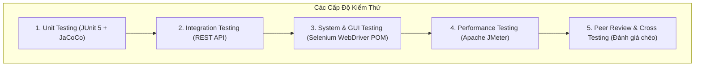
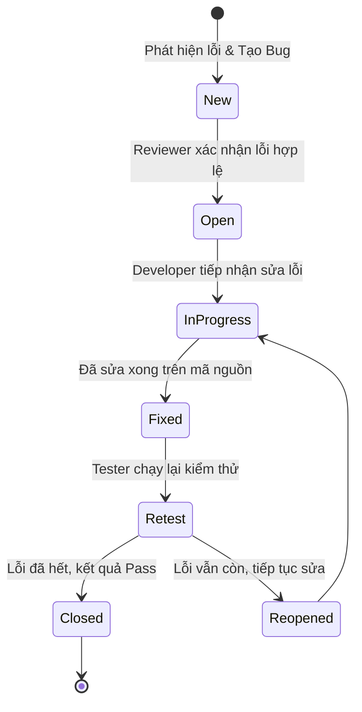

# KẾ HOẠCH ĐẢM BẢO CHẤT LƯỢNG & KIỂM THỬ PHẦN MỀM (SQA & TEST PLAN)
## DỰ ÁN: HỆ THỐNG TÍNH THUẾ THU NHẬP CÁ NHÂN (PIT SYSTEM)
### Chuẩn IEEE Std 829-2008 & IEEE Std 730

---

## 1. THÔNG TIN CHUNG (MANAGEMENT SUMMARY)

- **Tên dự án**: Hệ thống Tính thuế Thu nhập Cá nhân (Personal Income Tax - PIT System).
- **Môn học**: Kiểm thử Phần mềm (Software Testing & QA).
- **Phiên bản kế hoạch**: v1.0.
- **Ngày ban hành**: 01/10/2026.
- **Tiêu chuẩn áp dụng**: IEEE Std 829-2008 (Test Plan) & IEEE Std 730-2014 (SQA Plan).

---

## 2. KẾ HOẠCH ĐẢM BẢO CHẤT LƯỢNG PHẦN MỀM (SQA PLAN)

### 2.1. Mục tiêu chất lượng (Quality Objectives)
1. **Tính chính xác (Accuracy)**: 100% các công thức tính thuế lũy tiến 7 bậc và các khoản bảo hiểm, giảm trừ phải cho kết quả số học chính xác đến từng đồng VNĐ theo quy định của Luật Thuế TNCN Việt Nam.
2. **Độ bao phủ mã nguồn (Code Coverage)**: Độ phủ dòng lệnh (Line Coverage) đạt tối thiểu **90%** và độ phủ rẽ nhánh (Branch Coverage) đạt tối thiểu **75%** trên toàn bộ tầng nghiệp vụ (Service) và tiện ích (Util) được đo lường bằng **JaCoCo**.
3. **Mức độ hoàn thành kiểm thử**: 100% các ca kiểm thử trong Test Case Specification được thực thi. Tỷ lệ ca kiểm thử đạt (Pass Rate) phải đạt **100%** đối với các lỗi mức độ nghiêm trọng Critical và High trước khi nghiệm thu.
4. **Tính ổn định & Hiệu năng**: Thời gian phản hồi trung bình của hệ thống dưới **1.0 giây** khi chịu tải 100 người dùng đồng thời; tỷ lệ lỗi (Error Rate) dưới **1%**.

### 2.2. Các hoạt động Đảm bảo chất lượng (SQA Activities)
- **Review tài liệu yêu cầu (Requirements Review)**: Đánh giá tài liệu SRS theo chuẩn IEEE 830, đảm bảo không có yêu cầu mập mờ, thiếu nhất quán hoặc không thể kiểm thử.
- **Review thiết kế ca kiểm thử (Test Case Review)**: Đảm bảo các kỹ thuật thiết kế hộp đen (Phân tích giá trị biên BVA, Phân vùng tương đương EP, Bảng quyết định) được áp dụng đầy đủ cho 7 bậc thuế.
- **Code Review**: Đánh giá mã nguồn theo Java Code Conventions, cấu trúc sạch, xử lý ngoại lệ chặt chẽ, không hard-code dữ liệu bí mật.
- **Đo lường tự động (Automated Auditing)**: Sử dụng Maven Surefire và JaCoCo tự động kiểm tra lỗi và đo độ phủ sau mỗi lần build.

---

## 3. KẾ HOẠCH KIỂM THỬ (TEST PLAN)

### 3.1. Phạm vi kiểm thử (Scope)

#### A. Các tính năng thuộc phạm vi kiểm thử (Features to be Tested)
- **Nhóm chức năng 1: Người nộp thuế (Taxpayer)**:
  - Xác thực: Đăng ký tài khoản mới, kiểm tra ràng buộc định dạng dữ liệu (Username, Password, MST, CCCD, Email, SĐT), Đăng nhập, Đăng xuất, Lưu phiên Session.
  - Tính thuế nhanh (Quick Calculator): Tính nhẩm thuế 7 bậc cho người dùng vãng lai.
  - Kê khai thông tin thuế: Nhập lương, thưởng, thu nhập khác, miễn thuế, số người phụ thuộc, từ thiện theo kỳ kê khai (tháng, năm).
  - Bảng tính thuế tự động: Tính toán giảm trừ bản thân, giảm trừ người phụ thuộc, bảo hiểm bắt buộc (BHXH 8%, BHYT 1.5%, BHTN 1%), tính thu nhập chịu thuế, thu nhập tính thuế, diễn giải chi tiết số thuế theo 7 bậc lũy tiến.
  - Đóng thuế trực tuyến: Chọn phương thức (VNPAY-QR, Chuyển khoản, Thẻ ngân hàng), xác nhận nộp thuế, đổi trạng thái tờ khai sang `PAID`.
  - Biên lai nộp thuế điện tử: Sinh mã biên lai, mã giao dịch, kiểm tra thông tin biên lai và chức năng in biên lai.
- **Nhóm chức năng 2: Quản trị viên / Cán bộ thuế (Admin)**:
  - Theo dõi danh sách tờ khai: Hiển thị bảng tờ khai toàn hệ thống, 3 khối thống kê số liệu (Tổng tờ khai, Tiền thuế đã thu, Tiền thuế chờ nộp).
  - Lọc và tìm kiếm: Lọc tờ khai theo Năm, Tháng, Trạng thái (`PAID`, `PENDING`), tìm kiếm theo từ khóa Họ tên, MST, CCCD.
  - Xuất báo cáo quyết toán thuế: Xuất file CSV chuẩn UTF-8 BOM, mở bằng Excel tiếng Việt không lỗi font.
  - Cấu hình hệ thống: Xem cấu hình hiện tại, cập nhật mức giảm trừ bản thân, giảm trừ người phụ thuộc, tỷ lệ bảo hiểm, trần bảo hiểm; nút khôi phục cấu hình mặc định.
- **Kiểm thử phi chức năng**:
  - Giao diện người dùng GUI và trải nghiệm người dùng (UX).
  - Tính tương thích trình duyệt (Google Chrome, Microsoft Edge).
  - Khả năng chịu tải và hiệu năng bằng Apache JMeter (100 concurrent threads).
  - Phân quyền bảo mật (RBAC): Chặn người dùng thường truy cập tài nguyên quản trị.

#### B. Các tính năng không thuộc phạm vi kiểm thử (Features not to be Tested)
- Tích hợp cổng thanh toán thực tế với ngân hàng qua API trực tiếp (hệ thống sử dụng cổng mô phỏng Gateway Simulation có đầy đủ mã QR và mã giao dịch).
- Chữ ký số USB Token phần cứng chuyên dụng.

### 3.2. Chiến lược & Kỹ thuật kiểm thử (Testing Strategy)

1. **Kiểm thử đơn vị (Unit Testing)**:
   - Công cụ: **JUnit 5 (Jupiter)**.
   - Đối tượng: Toàn bộ các phương thức trong `TaxCalculatorService`, `ValidationUtil`, `UserService`, `DeclarationService`, `PaymentService`, `ConfigService`.
   - Kỹ thuật: Phân tích giá trị biên (BVA) tại các mốc 5tr, 10tr, 18tr, 32tr, 52tr, 80tr; Phân vùng tương đương (EP); Kiểm thử tham số hóa `@ParameterizedTest`, `@CsvSource`.
2. **Kiểm thử tích hợp (Integration Testing)**:
   - Kiểm tra tương tác giữa Controller và Service qua các REST API endpoints (`/api/auth/*`, `/api/tax/*`, `/api/admin/*`).
3. **Kiểm thử hệ thống & Tự động hóa giao diện (System & Automation Testing)**:
   - Công cụ: **Selenium WebDriver**.
   - Kiến trúc: **Page Object Model (POM)**.
   - Đối tượng: Các kịch bản người dùng toàn trình (End-to-End User Journeys): Đăng ký -> Đăng nhập -> Kê khai -> Đóng thuế -> Xem biên lai -> Admin kiểm tra & xuất báo cáo -> Cấu hình.
4. **Kiểm thử hiệu năng (Performance Testing)**:
   - Công cụ: **Apache JMeter**.
   - Mô hình tải: 100 concurrent threads (50 threads tính thuế nhanh, 20 threads nộp tờ khai, 30 threads truy vấn danh sách).
   - Chỉ số đo: Response Time, Throughput, Error Rate.
5. **Kiểm thử chéo & Đánh giá đồng đẳng (Peer Review)**:
   - Thực hiện kiểm thử và đánh giá sản phẩm của các nhóm sinh viên khác theo biểu mẫu chuẩn (YC 9).

### 3.3. Tiêu chí Dừng và Tiếp tục (Suspension & Resumption Criteria)
- **Tiêu chí dừng kiểm thử (Suspension)**:
  - Ứng dụng Web Spring Boot không thể biên dịch hoặc không khởi động được trên cổng 8080.
  - Phát sinh lỗi nghiêm trọng (Blocker/Critical) ngăn cản hoàn toàn việc đăng nhập hoặc tính sai số thuế ở bậc 1 làm tê liệt các ca kiểm thử tiếp theo.
- **Tiêu chí tiếp tục kiểm thử (Resumption)**:
  - Lỗi Blocker/Critical được khắc phục, ứng dụng khởi động thành công và vượt qua kiểm thử đơn vị cơ bản.

### 3.4. Tiêu chí Hoàn thành Kiểm thử (Exit / Acceptance Criteria)
1. 100% ca kiểm thử trong Test Case Specification được thực thi.
2. 0 lỗi mức độ Blocker / Critical còn tồn đọng.
3. Độ bao phủ mã nguồn Unit Test đạt trên **90%** (xác nhận qua báo cáo JaCoCo HTML).
4. Bộ kiểm thử tự động Selenium WebDriver chạy thành công không có lỗi gãy luồng chính.
5. Kịch bản kiểm thử hiệu năng JMeter chạy đạt thời gian phản hồi $< 1000\text{ ms}$ cho 100 người dùng đồng thời.
6. Toàn bộ tài liệu bàn giao (SRS, Test Plan, Checklist, Test Cases, Hướng dẫn chạy) được hoàn tất đầy đủ.

---

## 4. MÔI TRƯỜNG KIỂM THỬ & CÔNG CỤ (TEST ENVIRONMENT & TOOLS)

### 4.1. Môi trường kiểm thử
| Thành phần | Đặc tả kỹ thuật |
| :--- | :--- |
| **Hệ điều hành** | Microsoft Windows 11 64-bit |
| **Môi trường Java** | OpenJDK 23 / 17 (Java HotSpot 64-Bit) |
| **Build Tool** | Apache Maven 3.9.9 |
| **Máy chủ ứng dụng** | Spring Boot 3.2.1 (Embedded Tomcat) tại `http://localhost:8080` |
| **Cơ sở dữ liệu** | H2 Database In-Memory & Concurrent Persistence |
| **Trình duyệt Web** | Google Chrome phiên bản 140+ (chế độ Headed & Headless) |

### 4.2. Công cụ kiểm thử sử dụng
- **JUnit 5 (Jupiter)**: Viết và thực thi ca kiểm thử đơn vị, kiểm thử tham số hóa.
- **JaCoCo Maven Plugin (v0.8.11)**: Phân tích và sinh báo cáo độ phủ mã nguồn trực quan định dạng HTML.
- **Selenium WebDriver (v4.50)**: Tự động hóa kiểm thử giao diện Web đầu cuối theo mô hình POM.
- **Apache JMeter (v5.6+)**: Thiết kế kịch bản tải đa luồng và đo lường các chỉ số hiệu năng.

---

## 5. QUY TRÌNH QUẢN LÝ LỖI (DEFECT MANAGEMENT PROCESS)

### 5.1. Vòng đời của lỗi (Defect Lifecycle)

### 5.2. Ma trận Mức độ nghiêm trọng (Severity Matrix)
| Mức độ | Định nghĩa | Ví dụ trong hệ thống thuế |
| :--- | :--- | :--- |
| **Critical (Blocker)** | Lỗi làm sập hệ thống hoặc tê liệt hoàn toàn chức năng chính; tính sai lệch thuế nghiêm trọng | Ứng dụng không khởi động được; tính sai tiền thuế ở Bậc 1 khiến công dân không thể đóng thuế. |
| **Major (High)** | Chức năng quan trọng không hoạt động đúng nhưng vẫn có giải pháp thay thế tạm thời | Không xuất được file báo cáo CSV; tính sai mức giảm trừ gia cảnh khi có 2 người phụ thuộc. |
| **Medium (Normal)** | Lỗi giao diện, định dạng hoặc validation thiếu nhất quán | Thông báo lỗi tiếng Việt hiển thị sai chính tả; số tiền không có dấu phân cách hàng nghìn. |
| **Minor (Low)** | Lỗi thẩm mỹ nhỏ không ảnh hưởng đến nghiệp vụ tính toán | Căn lề nút bấm bị lệch 2px; icon bị mờ trên màn hình độ phân giải thấp. |

---

## 6. PHÂN CÔNG NHÂN SỰ & LỊCH TRÌNH (ROLES & SCHEDULE)

| Giai đoạn | Nhiệm vụ chính | Sản phẩm đầu ra | Người phụ trách |
| :---: | :--- | :--- | :--- |
| **Tuần 1** | Khảo sát luật thuế TNCN, viết tài liệu đặc tả SRS (YC 1) | `docs/YC1_Dac_ta_yeu_cau_SRS.md` | Nhóm trưởng / BA |
| **Tuần 2** | Cài đặt hệ thống Web Java Spring Boot (YC 2) | Mã nguồn Java, UI Bootstrap 5, REST API | Lập trình viên |
| **Tuần 3** | Lập SQA & Test Plan (YC 3), Xây dựng 6 Checklist (YC 4) | `docs/YC3_SQA_and_Test_Plan.md`, `docs/YC4_Test_Checklists.md` | SQA Lead / Tester |
| **Tuần 4** | Thiết kế Test Cases & Thực thi (YC 5), Viết JUnit 5 (YC 6) | `docs/YC5_Test_Cases_and_Execution.md`, 98 JUnit 5 Tests, JaCoCo Report | Tester / Dev |
| **Tuần 5** | Tự động hóa Selenium WebDriver (YC 7), JMeter (YC 8) | Kịch bản Selenium POM, Kịch bản JMeter `.jmx` | Automation Tester |
| **Tuần 6** | Thực hiện Review chéo cho nhóm khác (YC 9) & Nghiệm thu | `docs/YC9_Peer_Review_and_Evaluation.md`, Biên bản nghiệm thu | Cả nhóm |

---

## 7. ĐÁNH GIÁ RỦI RO & BIỆN PHÁP PHÒNG NGỪA (RISK & MITIGATION)

| Rủi ro tiềm ẩn | Mức độ | Biện pháp phòng ngừa & Xử lý |
| :--- | :---: | :--- |
| **R1: Chính sách thuế thay đổi mức giảm trừ gia cảnh** | Cao | Đưa toàn bộ mức giảm trừ và thuế suất vào module `SystemConfig` và cung cấp màn hình quản trị cấu hình động cho Admin, không hard-code trong mã nguồn. |
| **R2: Sai số làm tròn tiền tệ khi tính lũy tiến từng phần** | Trung bình | Sử dụng hàm làm tròn số nguyên chuẩn `Math.round()` trên đơn vị VNĐ và cài đặt kiểm tra đối chiếu kép bằng cả phương pháp lũy tiến và công thức rút gọn trong Unit Test. |
| **R3: Kiểm thử tự động Selenium bị flaky do mạng hoặc độ trễ DOM** | Trung bình | Áp dụng cơ chế chờ tường minh `WebDriverWait` (Explicit Wait) với `ExpectedConditions` thay vì dùng `sleep` cứng; gắn thuộc tính `data-testid` duy nhất cho mọi thành phần giao diện. |
| **R4: Lỗi font tiếng Việt khi mở file báo cáo trên Excel** | Thấp | Thêm ký tự UTF-8 Byte Order Mark (`\uFEFF`) vào đầu file CSV xuất ra để Microsoft Excel tự động nhận diện bảng mã UTF-8. |
